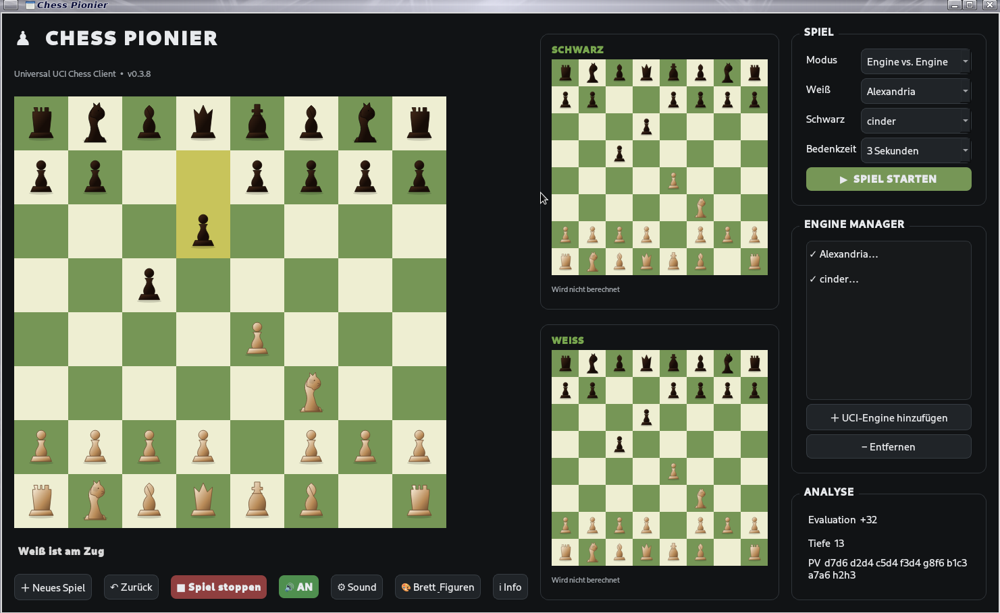

# Chess Pionier

**Version 0.3.15**

Universaler UCI-Schachclient mit Spielbrett, Engine-Verwaltung, PGN-Laden/Speichern, Analysefenster, Figuren-/Brettdesigns, Deutsch/Englisch und Soundeinstellungen.



[Github Seite](https://github.com/Angonikro/Chess-Pionier/)

## Installation als Debian-Paket

```bash
sudo apt install ./chess-pionier_0.3.15_all.deb
```

Danach kann **Chess Pionier** über das Anwendungsmenü oder mit `chess-pionier` gestartet werden.

## Start aus dem GitHub-Quellcode

```bash
sudo apt install python3-pyside6.qtwidgets python3-pygame
./install_dependencies.sh
python3 main.py
```

Alternativ die Pakete aus `requirements.txt` in einer eigenen Python-Umgebung installieren.

## Speicherorte unter Linux

Persönliche Einstellungen werden nicht mehr im Programmordner abgelegt:

- Einstellungen (Sprache, Brettdarstellung, Sound): `~/.config/chess-pionier/settings.ini`
- Gespeicherte Schach-Engines: `~/.config/chess-pionier/engines.json`
- Für spätere benutzerspezifische Daten: `~/.local/share/chess-pionier/`

Die Anwendung übernimmt vorhandene `data/settings.ini` und `engines.json` aus dem bisherigen Programmordner, wenn am neuen Ort noch keine entsprechende Datei existiert. Die alten Dateien werden dabei nicht gelöscht.

PGN-Dateien werden weiterhin an dem Ort gespeichert, den du im Speichern-Dialog auswählst.

## Abhängigkeiten

Die Python-Abhängigkeiten stehen in `requirements.txt`. Unter Debian 13 ist `python3-chess` nicht in jeder konfigurierten Paketquelle verfügbar. Deshalb enthält die DEB keine harte Abhängigkeit auf dieses Paket. Für die Schachbibliothek bitte das mitgelieferte Installationsskript verwenden:

```bash
./install_dependencies.sh
```

## Lizenz / Projekt

Chess Pionier – Universal UCI Chess Client.

73 de DO2QG Andreas
